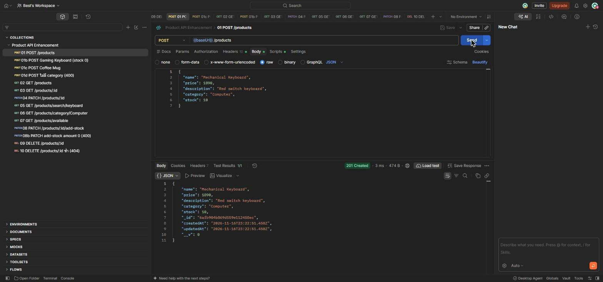
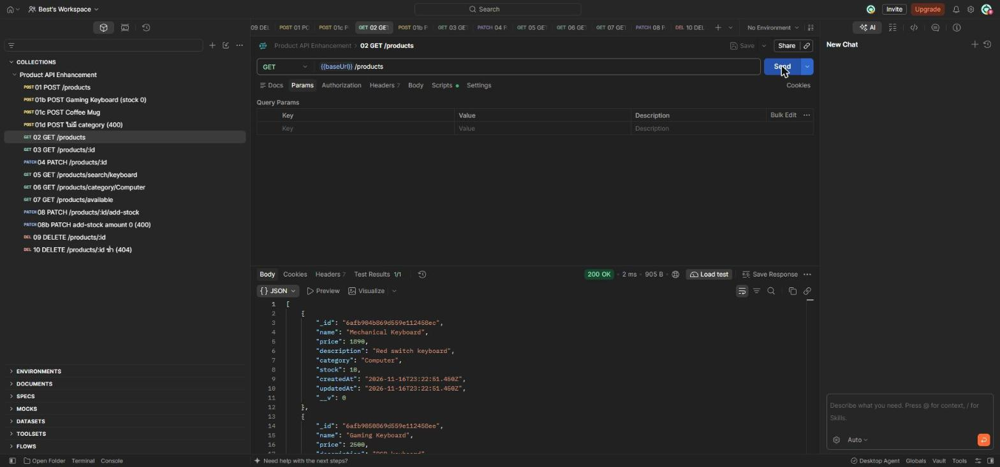
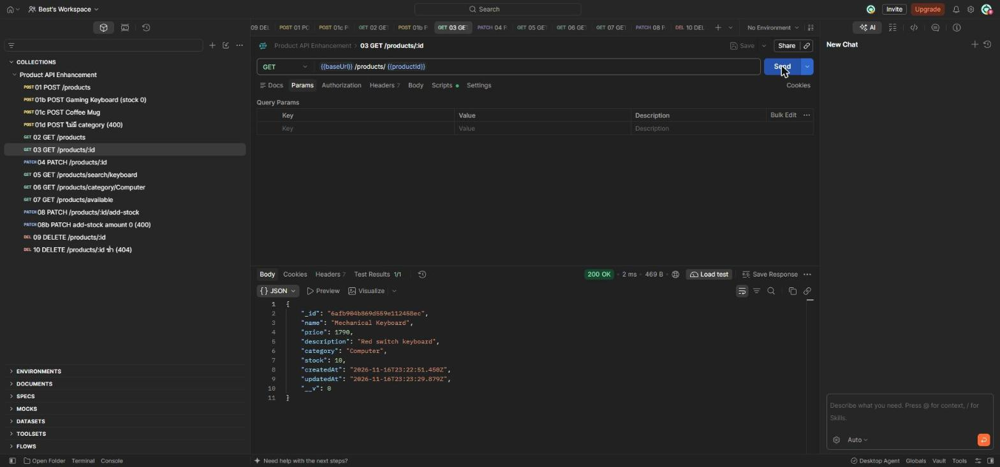
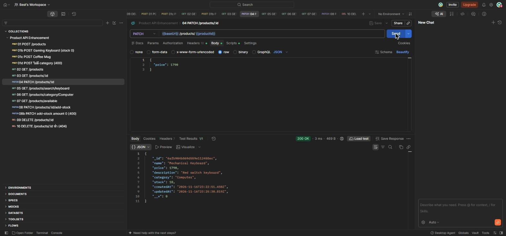
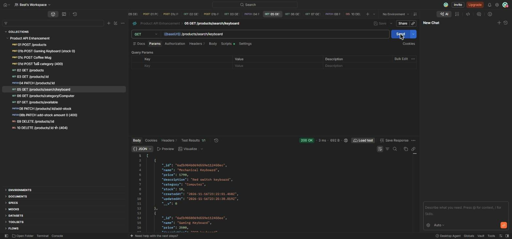
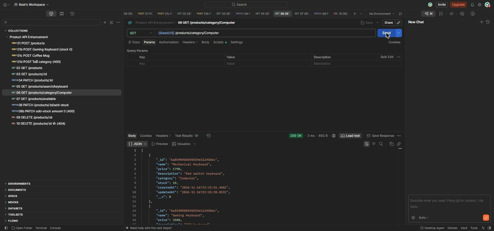
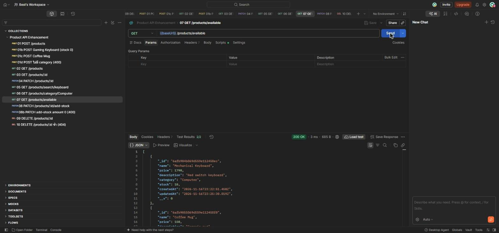
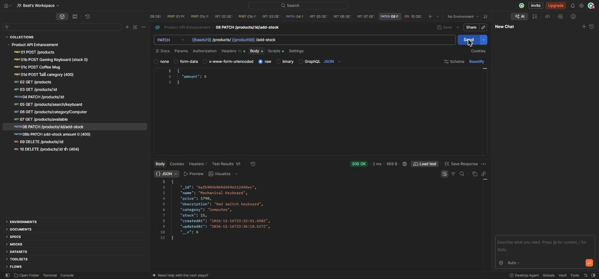
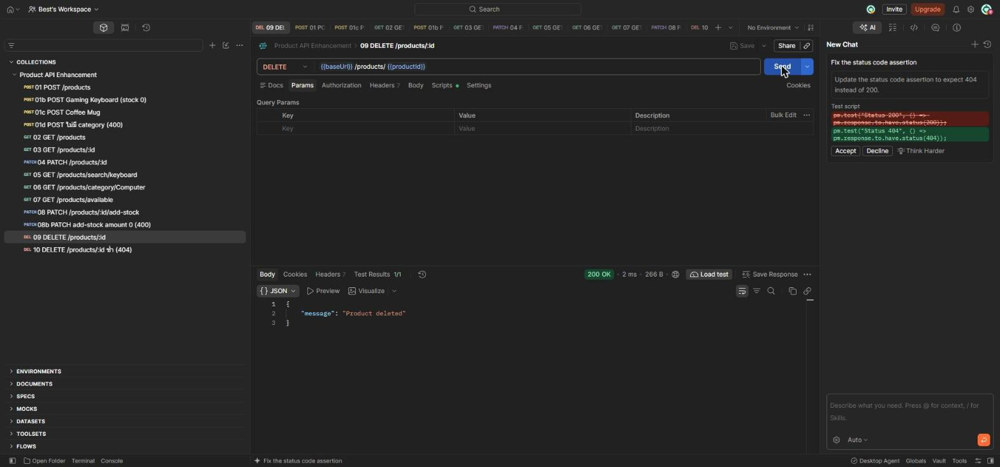
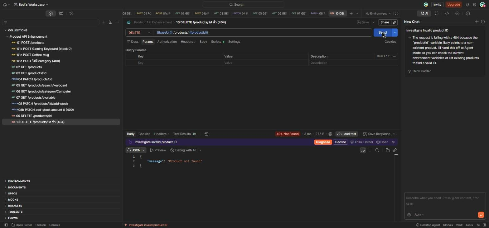

# Assignment 7 — Product REST API Enhancement

ต่อยอด Product CRUD เดิมด้วย **Express + MongoDB/Mongoose** เพิ่ม Schema Validation, Search/Filter, Stock Management และปรับ Delete ให้ปลอดภัยขึ้น

## โครงสร้างไฟล์

| ไฟล์ | หน้าที่ |
|---|---|
| `server.js` | Express app และทุก route |
| `models/Product.js` | ProductSchema (เพิ่ม `category`, `stock`) |
| `test.js` | สคริปต์ทดสอบอัตโนมัติ 19 กรณี (ใช้ MongoDB ในหน่วยความจำ) |
| `dev.js` | รันเซิร์ฟเวอร์พร้อม MongoDB ในตัว ไม่ต้องติดตั้งเพิ่ม |
| `Product-API.postman_collection.json` | Postman collection 14 request พร้อมใช้ |

## วิธีรัน

```bash
npm install
npm run dev        # รันพร้อม MongoDB ในตัว (ไม่ต้องติดตั้ง MongoDB) → http://localhost:3000
npm start          # ใช้ MongoDB ของเครื่องที่ mongodb://127.0.0.1:27017 (หรือตั้ง MONGO_URI)
npm test           # ทดสอบอัตโนมัติ 19 กรณี
```

**ทดสอบด้วย Postman:** Import ไฟล์ `Product-API.postman_collection.json` แล้วกด Send ทีละ request ตามลำดับ
(request แรกจะเก็บ `_id` ไว้ในตัวแปร `{{productId}}` ให้อัตโนมัติ)

## ข้อ 1: Schema

```js
category: { type: String, required: true },     // จำเป็นต้องกรอก
stock:    { type: Number, default: 0, min: 0 }  // ค่าเริ่มต้น 0, ห้ามติดลบ
```

ถ้าไม่ส่ง `category` หรือส่ง `stock` ติดลบ → ตอบ **400 Bad Request** (PATCH ใช้ `runValidators: true` ให้ตรวจด้วย)

## คำอธิบาย Endpoint

| Method | Route | ทำอะไร | Status |
|---|---|---|---|
| POST | `/products` | สร้างสินค้าใหม่จาก `req.body` | 201 / 400 |
| GET | `/products` | ดูสินค้าทั้งหมด | 200 |
| GET | `/products/:id` | ดูสินค้าตาม id | 200 / 404 / 400 |
| PATCH | `/products/:id` | แก้ไขบาง field ของสินค้า (ตรวจ validation) | 200 / 404 / 400 |
| DELETE | `/products/:id` | ลบสินค้า — **ข้อ 6:** ถ้าไม่พบตอบ 404 `Product not found` แทนการตอบว่าลบแล้ว | 200 / 404 |
| GET | `/products/search/:keyword` | **ข้อ 2:** ค้นหาสินค้าที่ชื่อมี keyword (`$regex` + `$options: "i"` ไม่สนตัวเล็ก/ใหญ่) | 200 |
| GET | `/products/category/:category` | **ข้อ 3:** แสดงสินค้าในหมวดหมู่ที่ระบุ | 200 |
| GET | `/products/available` | **ข้อ 4:** แสดงเฉพาะสินค้าที่ `stock > 0` (`$gt: 0`) | 200 |
| PATCH | `/products/:id/add-stock` | **ข้อ 5:** เพิ่ม stock ตาม `amount` ด้วย `$inc` — `amount <= 0` ตอบ 400, ไม่พบสินค้าตอบ 404 | 200 / 400 / 404 |

> **หมายเหตุ:** route `/products/search`, `/category`, `/available` ต้องประกาศ **ก่อน** `/products/:id` ไม่เช่นนั้น Express จะมองคำว่า `available` เป็นค่า `:id`

## ตัวอย่าง Request

```http
POST /products
{"name":"Mechanical Keyboard","price":1890,"description":"Red switch keyboard","category":"Computer","stock":10}

PATCH /products/<id>/add-stock
{"amount": 5}          → stock 10 → 15
```

## ผลทดสอบ (Postman / Thunder Client)

ทดสอบด้วย Postman (Web + Desktop Agent) ยิงไปที่ `http://localhost:3000`

| # | Request | Screenshot |
|---|---|---|
| 1 | `POST /products` |  |
| 2 | `GET /products` |  |
| 3 | `GET /products/:id` |  |
| 4 | `PATCH /products/:id` |  |
| 5 | `GET /products/search/keyboard` |  |
| 6 | `GET /products/category/Computer` |  |
| 7 | `GET /products/available` |  |
| 8 | `PATCH /products/:id/add-stock` |  |
| 9 | `DELETE /products/:id` |  |
| 10 | `DELETE /products/:id` (id ที่ลบไปแล้ว → 404) |  |

### ผล `npm test`

```
19 passed, 0 failed
```
